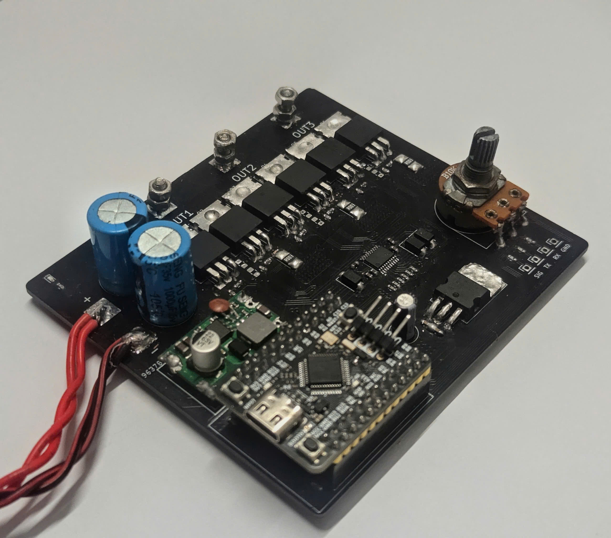

# Vortex FOC

**High-Performance Sensorless Field Oriented Control (FOC) Firmware for PMSM & BLDC Motors**  
*Optimized for STM32G4 microcontrollers with high-speed current loops, advanced sensorless observer, digital ESC protocols, and a real-time desktop configurator.*

---

[](https://www.youtube.com/watch?v=LBecr3bSMa8)

[](https://www.st.com/en/microcontrollers-microprocessors/stm32g4-series.html)
[]()
[](Tools/Configurator/)
[](Core/Src/input_dshot.c)
[](LICENSE)

---

## Overview

**Vortex FOC** is an open-source, ultra-fast, sensorless Field Oriented Control firmware tailored for high-speed brushless motors and drone ESCs. Built specifically around the STM32G431 microcontroller, it leverages hardware acceleration (CORDIC, internal OPAMPs, dual fast ADCs, and zero-wait-state CCMRAM) to deliver silky-smooth torque, fast dynamic response, and high efficiency.

---

## Key Features

- **Sensorless FOC Control**: Smooth, quiet, and highly efficient motor operation from standstill to extreme RPM without hall sensors.
- **Ultra-Fast Loop Rate**: Configurable 24 kHz to 64 kHz current loop running in CCMRAM for lightning-fast dynamic response.
- **3 Versatile Control Modes**: Supports **Speed Mode** (with disturbance-rejection LADRC), **Torque Mode** (direct current control for robotics/actuators), and **Voltage Mode** (duty cycle control for multirotors).
- **Smooth Startup & 3D Reversals**: Gentle S-curve ramp-up and seamless zero-crossing direction reversals without rotor slip.
- **Flying Start**: Instantly catches spinning or windmilling motors in either direction without current spikes.
- **DShot & Bi-Directional DShot**: Supports DShot150–1200 and BDShot300/600 with real-time eRPM telemetry for flight controller RPM filtering.
- **ESC Melodies & Beacon Beeps**: Power-on musical chimes, arming chirps, and lost-model beacon beepers directly through the motor coils.
- **Comprehensive Protection**: Fast hardware overcurrent (AWD), intelligent stall/desync detection, and voltage monitoring.
- **Automated Motor Identification**: One-click measurement of resistance (Rs), inductance (Ls), flux linkage, KV, and rotor inertia.
- **Real-Time Telemetry & GUI**: Live high-speed waveform plotting and instant parameter tuning over USB.

---

## Hardware Specifications

- **Microcontroller**: STM32G431 (ARM Cortex-M4F @ 170 MHz, CORDIC coprocessor, 10 KB CCMRAM)
- **Current Sensing**: 3-Shunt Low-Side topology (3 mΩ shunts, 15x internal OPAMP gain, 33A peak sensing ceiling)
- **Input Channels**: DShot / BDShot (PB7 / TIM4 CH2), Analog Potentiometer (PA0), or USB CDC Virtual COM port

---

## Desktop Configurator GUI

Vortex FOC comes with a custom Python desktop application (`Tools/Configurator/`) for real-time monitoring and parameter tuning:
- Live multi-channel plotting (speed, currents, voltages, duty cycles).
- Single-click Flash parameter read/write with explicit safety interlocks.
- Automated Motor Identification Wizard.
- Dynamic Response Profiler (Step, Chirp, PRBS noise tests).

---

## Quick Start

### 1. Build Firmware
Requires `arm-none-eabi-gcc` and `make`:
```bash
make -j4
```

### 2. Flash to MCU
Flash via ST-Link and OpenOCD:
```bash
make flash
```

### 3. Launch Configurator
```bash
cd Tools/Configurator
pip install -r requirements.txt
python main.py
```

---

## Author & License

- **Author**: Hoàng Danh Hiếu ([@hoangdanhhieu](https://github.com/hoangdanhhieu))
- **Email**: [hoangdanhhieu2003@gmail.com](mailto:hoangdanhhieu2003@gmail.com)
- **License**: Licensed under the **GNU General Public License v3.0 (GPLv3)**. See [LICENSE](LICENSE) for details.
